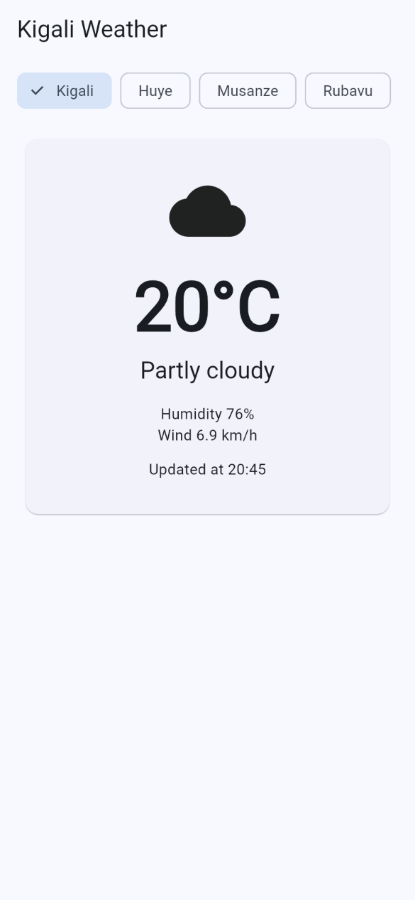
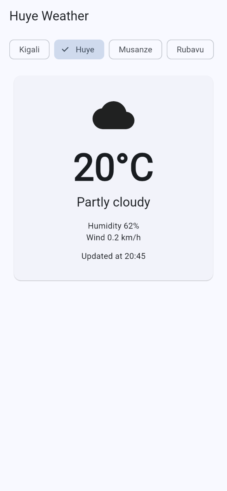
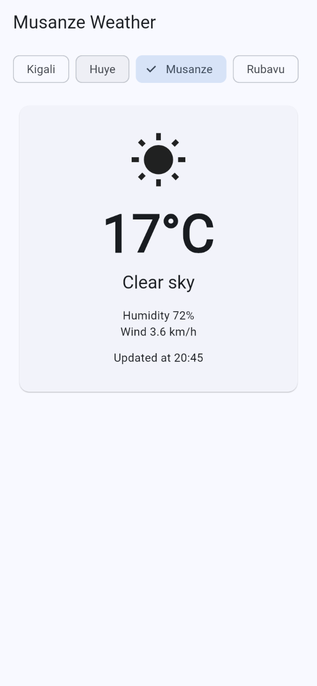
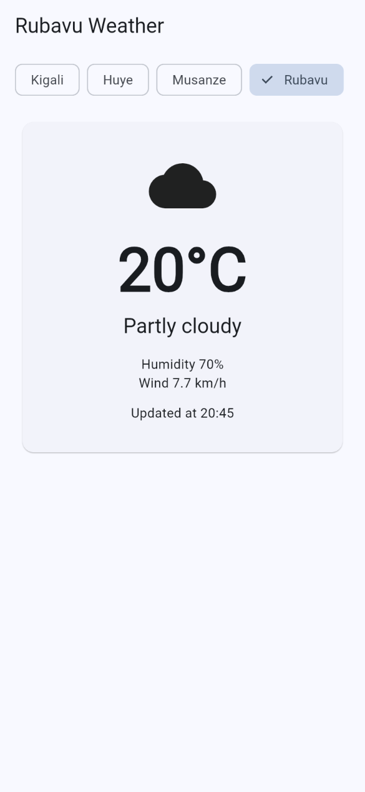
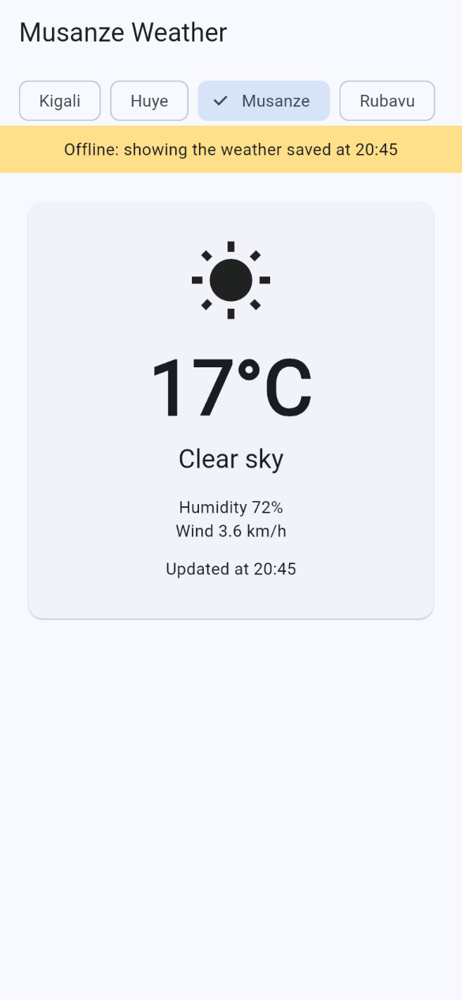
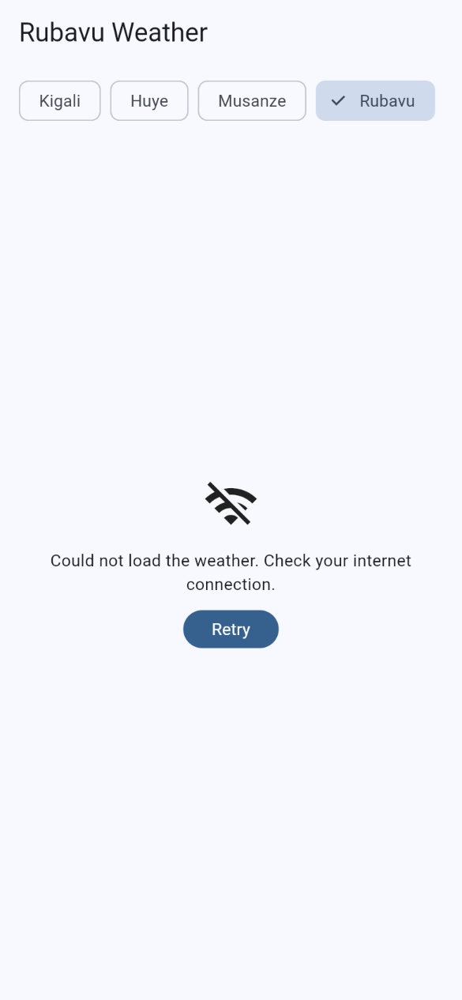

# Kigali Weather

A Flutter app that shows the live weather for four cities in Rwanda: Kigali, Huye, Musanze, and Rubavu. It was built for Mobile Programming, Session 5, "Data from the internet."

The app asks the free [Open-Meteo](https://open-meteo.com/) server, waits without freezing, and shows a weather card. If the phone has no internet, it does not crash: a city that was opened before still shows its last weather, and a city that was never opened shows a message and a Retry button. The city you choose is still selected the next time the app opens.

## What you see

The title follows the city, for example **Huye Weather**. Chips along the top choose the city. The card shows an icon for the sky, the temperature rounded to the nearest degree, the sky in words, the humidity, the wind, and the time the report was updated. Pull the page down to ask the server again.

These screenshots were taken on 26 October 2026, around 20:45.

**Kigali, the city the app opens on the first time.** 20°C, partly cloudy.



**Huye.** The chip is selected, the title changes, and the numbers are Huye's own: humidity 62% and wind 0.2 km/h, not Kigali's.



**Musanze.** 17°C and a clear sky, so each city is a separate request.



**Rubavu, after Retry.** This city had never been loaded. With the connection back, Retry asks the server and shows 20°C.



**No internet, but this city was opened before.** Musanze's last report stays on the screen, with a yellow banner: "Offline: showing the weather saved at 20:45."



**No internet, and this city was never opened.** Rubavu has nothing saved, so the app shows a clear message and Retry instead of an empty screen or a crash.



## How it is put together

| File | What it does |
| --- | --- |
| `lib/weather.dart` | The `Weather` and `City` models, `fromJson` and `toJson`, the sky words, and `fetchWeather` |
| `lib/main.dart` | The screen: chips, the three states, the card, the saved city, and the offline banner |
| `check_weather.dart` | Asks for Kigali's weather from the terminal, with no screen |
| `warmup.dart` | The Future practice: a brochette and a Fanta ordered at the same time |

`http` sends the request. `shared_preferences` stores the chosen city under the key `city`, and each city's last report under `weather_Kigali`, `weather_Huye`, `weather_Musanze`, and `weather_Rubavu`. One city never overwrites another.

A screen that loads data has three states, checked in this order:

1. **Loading.** A spinner.
2. **Error.** No internet, and nothing saved for that city. A message and Retry.
3. **Data.** The weather card. If the new request failed but an older report was saved, the card stays and the yellow banner says it is the saved one.

`fetchWeather` only accepts status code 200. Any other answer, or no connection at all, is caught, and the screen chooses between the saved report and the error.

## Run it

From this folder:

```powershell
cd "D:\Documents\innovation\mobile programming\kigali_weather"
```

The warm-up takes about 3 seconds, because both orders start together:

```powershell
dart run warmup.dart
```

The weather request on its own:

```powershell
dart run check_weather.dart
```

The app. On a machine with no Android emulator, Chrome is the device:

```powershell
flutter run -d chrome
```

With a phone or an emulator connected:

```powershell
flutter devices
flutter run
```

Leave the run window open. In that terminal, `r` reloads after a small change, `R` restarts the app, and `q` quits.
